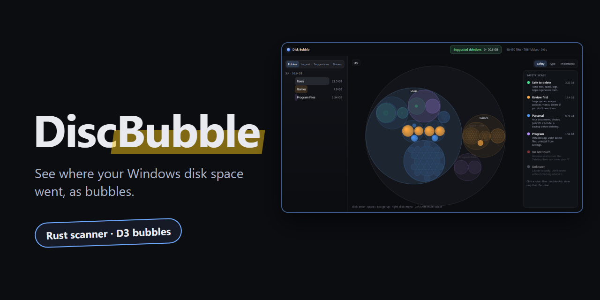
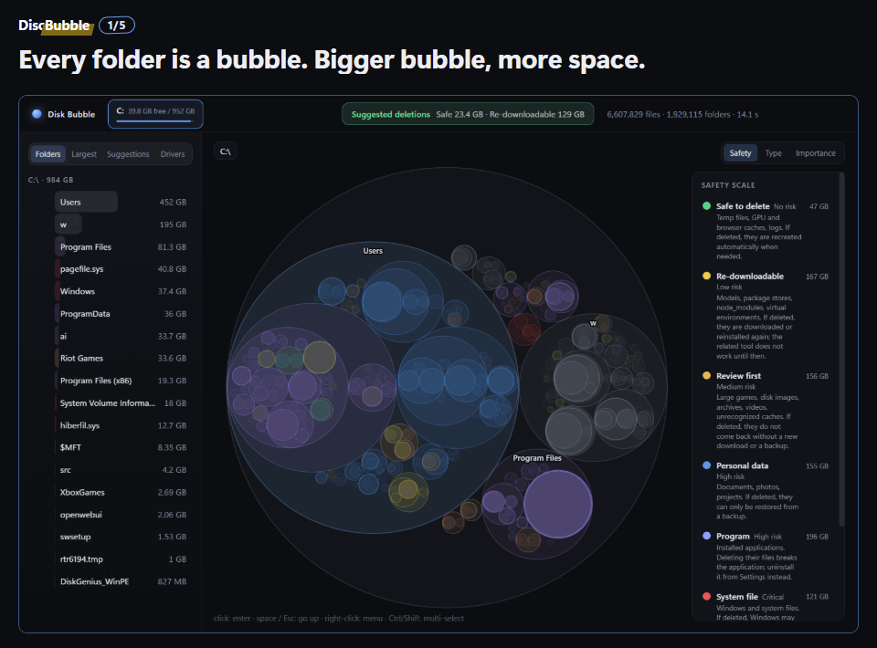
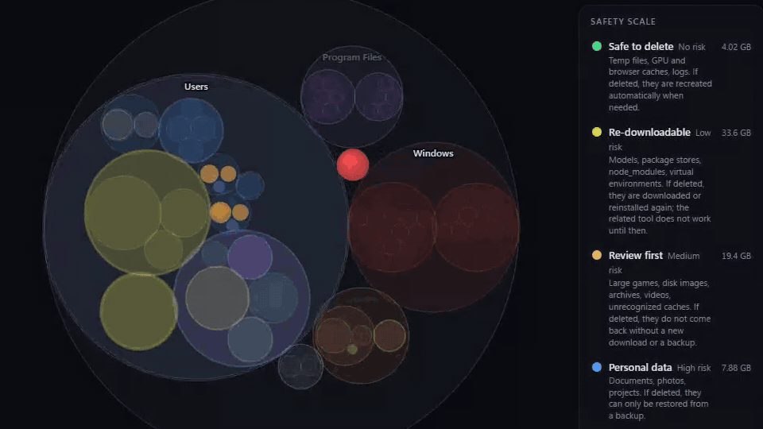
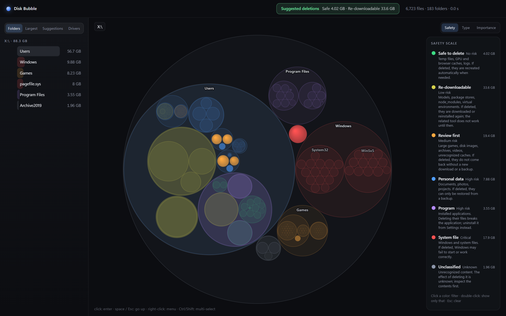
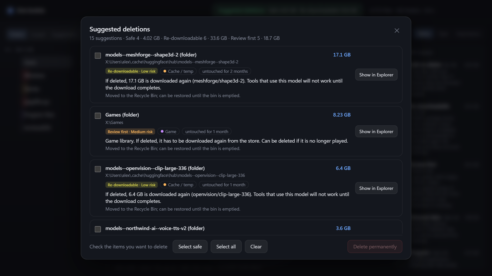
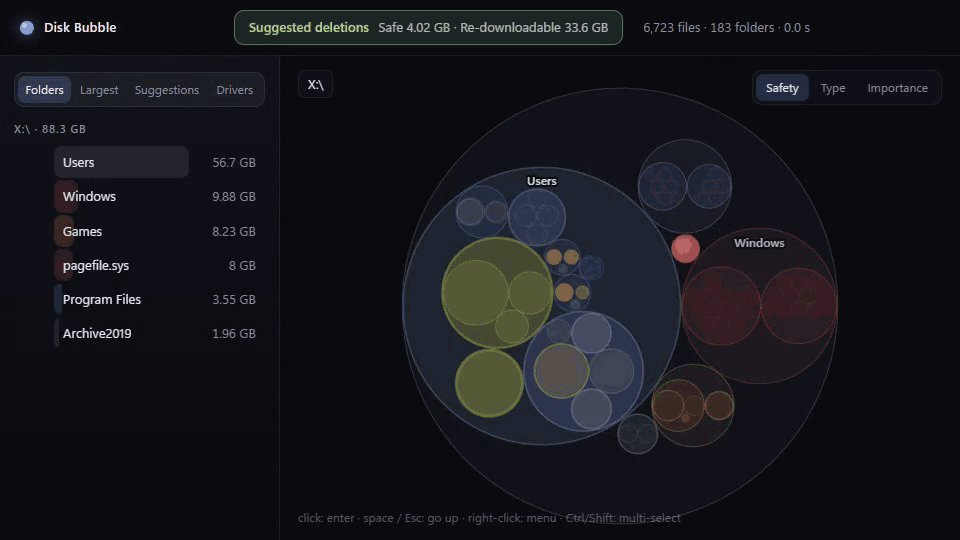
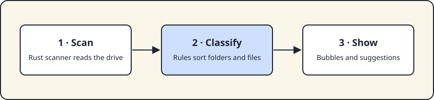

<p align="center"></p>
<p align="center"><b>English</b> · <a href="README.tr.md">Türkçe</a></p>

The storage page in Windows 11 felt too basic and too slow for me, so I built a small app for my own use. DiscBubble shows a disk as bubbles: the more space a folder or file takes, the bigger its bubble. It sorts everything into categories and suggests what you can delete, with a reason for each suggestion.

<p align="center"></p>

## What it does

- **Bubble view.** Every folder and file is a circle sized by its disk usage (D3 circle packing on a canvas). Click to zoom in, Esc to go up.
- **Three color modes.** Safety (safe to delete, re-downloadable, review first, personal data, program, system file, unclassified), file type, and importance. Each safety tier shows a risk level, from "No risk" to "Critical".
- **Cleanup suggestions.** Rule-based list of temp files, caches, model stores, `node_modules`, large archives and videos. Each item states what happens if it is deleted. A locked folder reports which program holds it (Windows Restart Manager).
- **Drivers tab.** Finds old and unused third-party driver packages in the Driver Store and removes them with `pnputil` (no `/force`, Windows refuses packages in use).

## Safety tiers

<p align="center"></p>

| Tier | Risk | Typical content | If deleted |
|---|---|---|---|
| Safe to delete | No risk | Temp files, GPU and browser caches, logs | Recreated automatically when needed |
| Re-downloadable | Low risk | Models, package stores, `node_modules`, virtual environments | Downloaded or reinstalled again; the related tool does not work until then |
| Review first | Medium risk | Large games, disk images, archives, videos, unrecognized caches | Gone unless downloaded again or restored from a backup |
| Personal data | High risk | Documents, photos, projects | Only restorable from a backup |
| Program | High risk | Installed applications | Breaks the application; uninstall it from Settings instead |
| System file | Critical | Windows and system files | Windows may fail to start or work correctly |
| Unclassified | Unknown | Unrecognized content | Unknown; inspect the contents first |

The tooltip names the tier, its risk level and the concrete consequence, for example "If deleted, 17.1 GB is downloaded again (meshforge/shape3d-2). Tools that use this model will not work until the download completes." Rules live in `public/classify.js`.

<p align="center"></p>

## Suggested deletions

<p align="center"></p>

The **Suggested deletions** badge totals Safe and Re-downloadable space separately. In the dialog, Safe items are deleted permanently; Re-downloadable and riskier items go to the Recycle Bin, and the confirmation repeats what deleting them costs.

<p align="center"></p>

## How it works

<p align="center"></p>

- A small Rust scanner (`bubblescan`) reads the drive and returns a folder tree with sizes. With administrator rights it reads the NTFS file table directly (`mft` mode); without them it walks the folders (`walk` mode).
- The Electron app draws that tree as bubbles, colors it by fixed rules and builds the suggestion list from the same rules.

## Quick start

Download the portable Windows x64 app from [GitHub Releases](https://github.com/Enesttombas/DiscBubble/releases/latest), or build from source.

Requirements: Windows, Node.js, and Rust (`cargo`) for the scanner.

```
npm install
cd scanner-rs && cargo build --release && cd ..
mkdir bin && copy scanner-rs\target\release\bubblescan.exe bin\
npm start
```

## Usage

Pick a drive (or relaunch as administrator for the fast `mft` scan), click bubbles to zoom, switch the color mode at the top right, and open **Suggested deletions** or the **Drivers** tab to clean up.

Bubble sizes use the allocated bytes of sparse and NTFS-compressed files. When the logical file size differs, it appears in the tooltip. In `walk` mode, ordinary files are counted by their logical size and hard links can be counted more than once.

## Limits

- Windows only. The Electron app runs `mft` mode only after a UAC prompt; without it, scans use `walk`.
- Scanning, deleting and driver cleanup only work inside the Electron app; `server.js` is legacy and not connected to the current UI.
- Cleanup rules are heuristics. Review the list before deleting; permanent deletion cannot be undone.
- `npm test` runs a syntax check plus unit tests of the classification (`test/`, fake tree data only). `node scripts/classify-path.js <folder>` prints the tiers for a real folder without deleting anything.

## License

[ISC](LICENSE).
