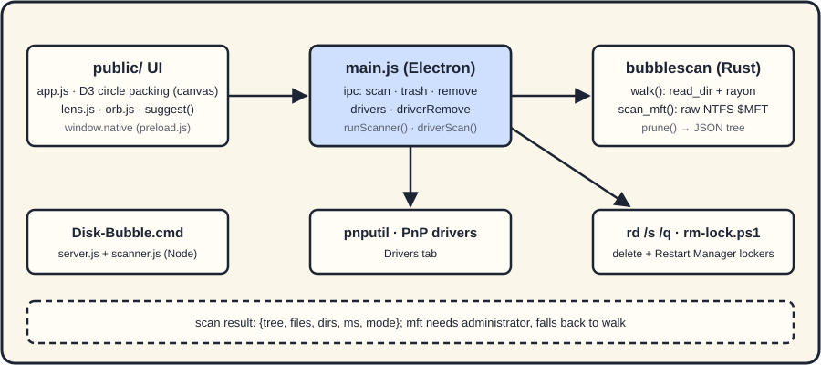

<p align="center"></p>
<p align="center"><b>English</b> · <a href="README.tr.md">Türkçe</a></p>

DiscBubble shows what fills a Windows disk as zoomable bubbles, suggests what is safe to delete, and cleans up unused driver packages. It is a personal tool built for my own machine.

<p align="center"></p>

## What it does

- **Bubble view.** Every folder and file is a circle sized by its disk usage (D3 circle packing on a canvas). Click to zoom in, Esc to go up.
- **Three color modes.** Safety (safe to delete, review first, personal, program, do not touch), file type, and importance.
- **Cleanup suggestions.** Rule-based list of temp files, caches, `node_modules`, large archives and videos, with a reason for each. Deletion goes to the Recycle Bin or is permanent, and a locked folder reports which program holds it (Windows Restart Manager).
- **Drivers tab.** Finds old and unused third-party driver packages in the Driver Store and removes them with `pnputil` (no `/force`, Windows refuses packages in use).

## How it works

<p align="center"></p>

- `scanner-rs/src/main.rs` (`bubblescan`) has two modes. `walk` uses `read_dir` with rayon. `mft` reads the raw NTFS `$MFT` of a whole drive and needs administrator rights; if it fails, the app falls back to `walk`.
- The scanner returns a pruned JSON tree (`prune()` merges small items). `main.js` runs it and passes the result to `public/app.js`.
- `scanner.js` is a plain Node scanner (also lists drives for the app and is what the benchmark compares against). `server.js` + `Disk-Bubble.cmd` are an older browser-mode server; the current UI talks to the Electron bridge (`window.native` in `preload.js`) and is not wired to it.
- The approach was informed by looking at how existing disk tools read the file table; I studied them with the REA reverse-engineering tool and re-implemented the idea in the Rust scanner.

## Numbers

<p align="center"></p>

Measured with `node bench/scan-bench.cjs 7 60000` on 2026-10-20 (Windows 11, 32 logical CPUs): median of 7 runs on a synthetic tree of 60,000 small files, Node `scanner.js` 11.51 s versus `bubblescan --mode walk` 0.124 s (includes process start and JSON write). Raw data: `docs/media/data/scan-bench.json`. The `mft` mode was not measured (needs administrator rights).

## Quick start

Requirements: Windows, Node.js, and Rust (`cargo`) for the scanner.

```
npm install
cd scanner-rs && cargo build --release && cd ..
mkdir bin && copy scanner-rs\target\release\bubblescan.exe bin\
npm start
```

## Usage

Pick a drive (or relaunch as administrator for the fast `mft` scan), click bubbles to zoom, switch the color mode at the top right, and open **Suggested deletions** or the **Drivers** tab to clean up.

## Limits

- Windows only. The Electron app runs `mft` mode only after a UAC prompt; without it, scans use `walk`.
- Scanning, deleting and driver cleanup only work inside the Electron app; `server.js` is legacy and not connected to the current UI.
- Cleanup rules are heuristics. Review the list before deleting; permanent deletion cannot be undone.
- There are no automated tests beyond `npm test` (a syntax check).

## License

[ISC](LICENSE).
