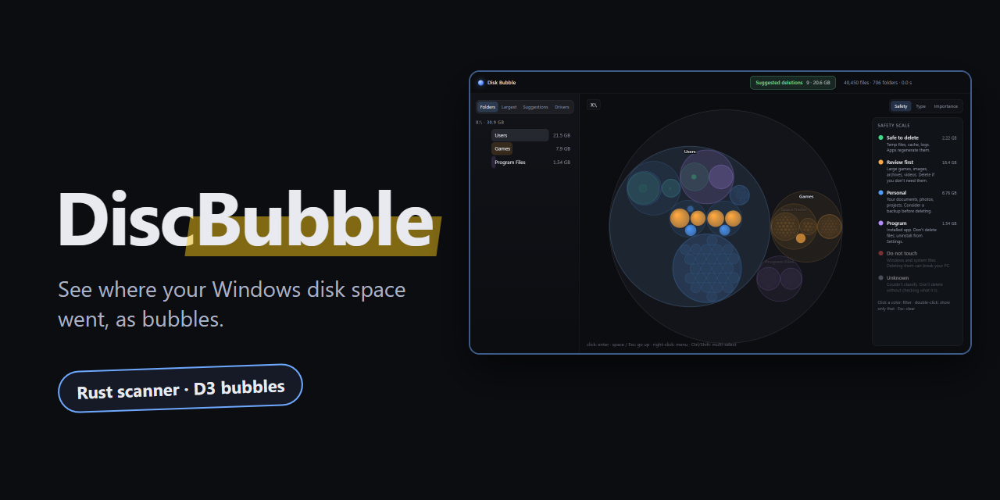
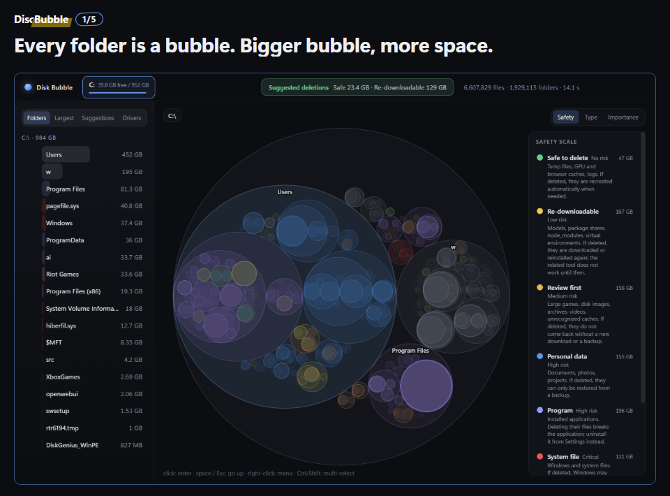
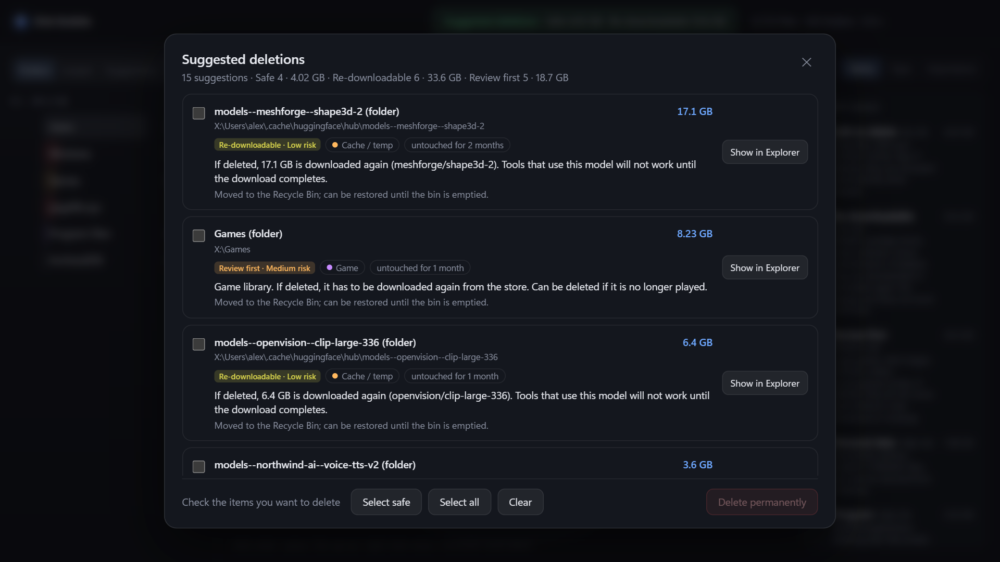
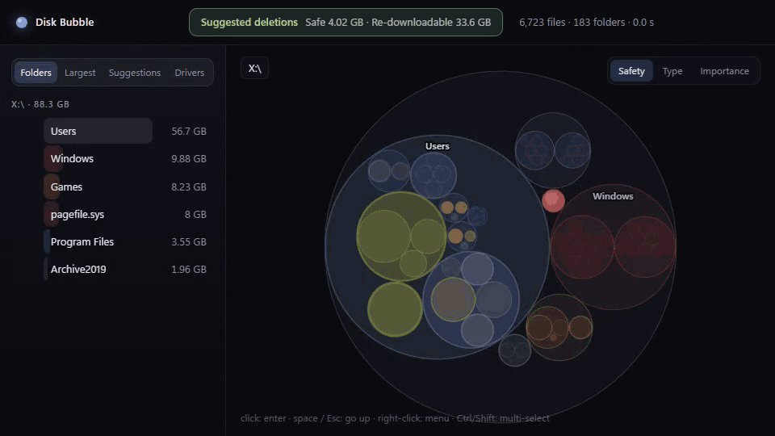
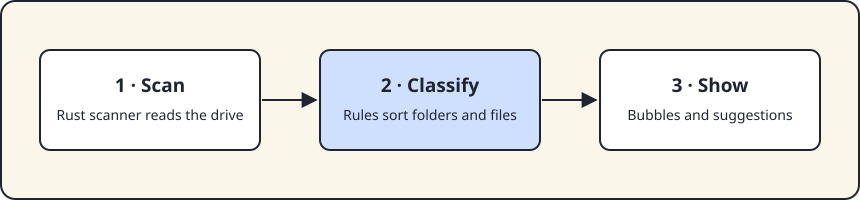

<p align="center"></p>
<p align="center"><a href="README.md">English</a> · <b>Türkçe</b></p>

Windows 11'in depolama ve yer açma sayfası bana çok basit ve çok yavaş geldi; kendi ihtiyacım için küçük bir uygulama yaptım. DiscBubble diski baloncuklarla gösterir: bir klasör ya da dosya ne kadar yer kaplıyorsa balonu o kadar büyüktür. Her şeyi kategorilere ayırır ve neyi silebileceğini gerekçesiyle önerir.

<p align="center"></p>

## Ne yapar

- **Baloncuk görünümü.** Her klasör ve dosya, disk kullanımıyla orantılı bir daire (canvas üzerinde D3 circle packing). Tıkla yakınlaş, Esc ile yukarı çık.
- **Üç renk modu.** Güvenlik (güvenle silinebilir, yeniden indirilebilir, kontrol edilmeli, kişisel veri, program, sistem dosyası, sınıflandırılmamış), dosya türü ve önem. Her güvenlik kademesinde "Risk yok"tan "Kritik"e kadar bir risk düzeyi gösterilir.
- **Temizlik önerileri.** Geçici dosya, önbellek, model deposu, `node_modules`, büyük arşiv ve video için kural tabanlı liste. Her öğe silinirse ne olacağını söyler. Kilitli klasörde hangi programın tuttuğu söylenir (Windows Restart Manager).
- **Sürücüler sekmesi.** Driver Store'daki eski ve kullanılmayan üçüncü taraf paketleri bulur, `pnputil` ile siler (`/force` yok, kullanımdaki paketi Windows reddeder).

## Güvenlik kademeleri

<p align="center"></p>

Arayüz İngilizcedir; kademe ve risk adları arayüzdeki gibi yazıldı.

| Kademe | Risk | Tipik içerik | Silinirse |
|---|---|---|---|
| Safe to delete | No risk | Geçici dosyalar, GPU ve tarayıcı önbellekleri, günlükler | Gerektiğinde kendiliğinden yeniden oluşur |
| Re-downloadable | Low risk | Modeller, paket depoları, `node_modules`, sanal ortamlar | Yeniden indirilir ya da kurulur; o zamana kadar ilgili araç çalışmaz |
| Review first | Medium risk | Büyük oyunlar, disk kalıpları, arşivler, videolar, tanınmayan önbellekler | Yeniden indirilmeden ya da yedekten dönülmeden geri gelmez |
| Personal data | High risk | Belgeler, fotoğraflar, projeler | Yalnız yedekten geri alınır |
| Program | High risk | Kurulu uygulamalar | Uygulama bozulur; onun yerine Ayarlar'dan kaldır |
| System file | Critical | Windows ve sistem dosyaları | Windows açılmayabilir ya da düzgün çalışmayabilir |
| Unclassified | Unknown | Tanınmayan içerik | Etkisi bilinmez; önce içeriğe bak |

İpucu kademeyi, risk düzeyini ve somut sonucu söyler, ör. "If deleted, 17.1 GB is downloaded again (meshforge/shape3d-2). Tools that use this model will not work until the download completes." Kurallar `public/classify.js` içinde.

<p align="center"></p>

## Önerilen silmeler

<p align="center"></p>

**Suggested deletions** rozeti Safe ve Re-downloadable alanı ayrı toplar. Pencerede Safe öğeler kalıcı silinir; Re-downloadable ve daha riskli öğeler Geri Dönüşüm Kutusu'na gider ve onay kutusu silmenin bedelini tekrar yazar.

<p align="center"></p>

## Nasıl çalışır

<p align="center"></p>

- Küçük bir Rust tarayıcısı (`bubblescan`) sürücüyü okur ve boyutlarıyla bir klasör ağacı döndürür. Yönetici hakkı varsa NTFS dosya tablosunu doğrudan okur (`mft` modu); yoksa klasörleri tek tek gezer (`walk` modu).
- Electron uygulaması bu ağacı baloncuk olarak çizer, sabit kurallarla renklendirir ve öneri listesini aynı kurallardan çıkarır.

## Hızlı başlangıç

Taşınabilir Windows x64 uygulamasını [GitHub Releases](https://github.com/Enesttombas/DiscBubble/releases/latest) sayfasından indir veya kaynak koddan derle.

Gerekenler: Windows, Node.js ve tarayıcı için Rust (`cargo`).

```
npm install
cd scanner-rs && cargo build --release && cd ..
mkdir bin && copy scanner-rs\target\release\bubblescan.exe bin\
npm start
```

## Kullanım

Bir sürücü seç (hızlı `mft` taraması için yönetici olarak yeniden başlat), baloncuklara tıklayıp yakınlaş, sağ üstten renk modunu değiştir, temizlik için **Suggested deletions** ya da **Drivers** sekmesini aç.

Seyrek ve NTFS sıkıştırmalı dosyaların baloncukları, diskte ayrılmış alana göre boyutlanır. Dosya boyutu farklıysa üzerine gelince ayrıca görünür. `walk` modunda normal dosyalar mantıksal boyutuyla sayılır ve sabit bağlantılar birden fazla kez sayılabilir.

## Sınırlar

- Yalnız Windows. Electron uygulaması `mft` modunu ancak UAC onayıyla çalıştırır; onaysız taramalar `walk` ile yapılır.
- Tarama, silme ve sürücü temizliği yalnız Electron uygulamasında çalışır; `server.js` eskidir, güncel arayüze bağlı değildir.
- Temizlik kuralları sezgiseldir. Silmeden önce listeyi gözden geçir; kalıcı silme geri alınamaz.
- `npm test` sözdizimi denetimine ek olarak sınıflandırmanın birim testlerini çalıştırır (`test/`, yalnız sahte ağaç verisi). `node scripts/classify-path.js <klasör>` gerçek bir klasörün kademelerini hiçbir şey silmeden yazdırır.

## Lisans

[ISC](LICENSE).
